

Anclora Talent

Manual de usuario

Crea, edita, valida y exporta tus proyectos editoriales desde un único sistema de trabajo.

  
Versión 2.0

  
19 octubre 2026

Guía práctica de la aplicación actual. Las capturas usan datos sintéticos de demostración y no contienen cuentas ni contenido personal.

## Índice

Esta guía sigue el recorrido completo de un proyecto editorial en Anclora Talent: acceder, configurar la base del proyecto, gestionar el documento y sus capítulos, diseñar cubierta, validar en vista previa, colaborar con el equipo, apoyarse en el asistente editorial gobernado y exportar archivos verificados.

- **Primeros pasos**: capítulos 1 a 4.
- **Trabajo editorial**: capítulos 5 a 8.
- **Cubierta, validación, colaboración, IA y exportación**: capítulos 9 a 11.
- **Dispositivos, preferencias y soporte**: capítulos 12 a 16.

| Capítulo | Para qué sirve |
| --- | --- |
| 1. Empieza aquí | Entender el producto y elegir tu recorrido |
| 2. Cuenta, acceso y recuperación | Entrar, registrarte y recuperar la contraseña |
| 3. Dashboard y proyectos | Localizar, filtrar, ordenar y abrir proyectos |
| 4. Crear un proyecto | Configurar título, documento base, plantilla, estilo y marca |
| 5. Workspace editorial | Recorrer los 8 pasos del sistema y el centro de control de Contenido |
| 6. Importar y preparar el manuscrito | Subir un documento, revisar su estructura y configurar Datos del documento |
| 7. Capítulos, edición y formato | Organizar capítulos y trabajar en el editor a pantalla completa |
| 8. Composición, metadatos, marca y versiones | Ajustar reglas tipográficas, pre-flight por canal e historial |
| 9. Portada y contraportada | Diseñar las superficies de cubierta en el estudio unificado |
| 10. Vista previa, colaboración y asistente IA | Validar paginación, revisar en equipo y aplicar propuestas IA |
| 11. Exportar | Generar y verificar PDF, EPUB, DOCX, HTML y Markdown |
| 12. Trabajar en móvil y tablet | Entender cómo se adapta la interfaz a pantallas estrechas |
| 13. Idioma, tema y preferencias | Cambiar ES/EN, oscuro/claro y opciones de visualización |
| 14. Si algo no funciona | Resolver las incidencias más habituales |
| 15. Preguntas frecuentes | Respuestas rápidas a dudas comunes |
| 16. Glosario | Significado de los términos editoriales de la aplicación |

## 1. Empieza aquí

Anclora Talent es una plataforma editorial interactiva diseñada para transformar un manuscrito o una idea inicial en una publicación lista para imprenta o distribución digital. Desde un mismo espacio puedes estructurar capítulos, editar con paginación real, aplicar reglas de composición y perfiles de marca, diseñar portada y contraportada, revisar con colaboradores, aplicar mejoras editoriales gobernadas por IA y exportar archivos verificados.

La aplicación se apoya en tres principios clave:

- **Un único documento canónico.** El editor de capítulos, la vista previa y todos los formatos de exportación leen la misma estructura y contenido.
- **Separación entre contenido y estilo.** Puedes cambiar plantilla, reglas de composición, documento de referencia o perfil de marca sin perder el texto ni el orden de tus capítulos.
- **Flujo editorial en 8 pasos.** Todo proyecto recorre una secuencia clara en la barra superior: **1. Contenido**, **2. Capítulos**, **3. Portada**, **4. Contraportada**, **5. Vista previa**, **6. Colaborar**, **7. Asistente IA** y **8. Exportar**.

### Qué puedes hacer

- Crear un proyecto desde cero o importar un manuscrito en `.docx`, `.doc`, `.odt`, `.md`, `.txt` o `.pdf`.
- Aplicar plantillas de producto (**Libro estándar**, **Manual técnico**, **Guía / lead magnet**, **Curso modular**, **Bundle**) y estilos editoriales de referencia.
- Gestionar metadatos editoriales, reglas de composición, perfiles de marca, pre-flight por canal (**KDP**, **IngramSpark**, **Kobo**) e historial de versiones desde **Contenido**.
- Ordenar capítulos y escribir en un editor multipágina con esquema lateral, inspector de salud, modo enfoque y posicionamiento de imágenes.
- Diseñar **Portada** y **Contraportada** sobre un lienzo interactivo con capas, plantillas editoriales, guías de sangrado y área segura.
- Validar el libro en **Vista previa** por destino de lectura (**Impresión**, **Escritorio**, **Tableta**, **Lector electrónico**) y modo (**Documento**, **Pliego**, **Portada**).
- Revisar el manuscrito en **Colaborar** mediante comentarios anclados a bloques y sugerencias por rol (**Autor**, **Corrector**, **Maquetador**).
- Ejecutar tareas en **Asistente IA** bajo revisión humana explícita (propuestas sobre el AST con diff antes/después y registro para divulgación KDP).
- Generar y verificar **PDF**, **EPUB**, **DOCX**, **HTML** y **Markdown** en **Exportar**.

### Elige tu recorrido

| Si estás en esta situación | Empieza por |
| --- | --- |
| Es tu primera visita | Capítulos 1 y 2 |
| Ya tienes un manuscrito en Word, ODT, Markdown o PDF | Capítulos 4 y 6 |
| Quieres escribir desde cero | Capítulos 4, 5 y 7 |
| Necesitas ajustar márgenes, tipografía o pre-flight KDP | Capítulo 8 |
| Quieres diseñar la cubierta delantera y trasera | Capítulo 9 |
| Vas a revisar paginación, comentar en equipo o usar IA | Capítulo 10 |
| Necesitas generar el archivo final para publicar | Capítulo 11 |

## 2. Cuenta, acceso y recuperación

### Crear una cuenta

**Cuándo usarlo:** cuando todavía no dispones de una cuenta en Anclora Talent.

1. Abre la página principal y pulsa **Crear cuenta**.
2. Introduce tu **Nombre completo**.
3. Introduce tu **Email**.
4. Define una **Contraseña** de al menos ocho caracteres que incluya letras y números.
5. Pulsa **Crear cuenta** (o utiliza el acceso con **Google** o **GitHub** si están habilitados en tu entorno).
6. Si algún campo necesita corrección, el formulario indicará el motivo junto al campo correspondiente conservando los datos válidos.

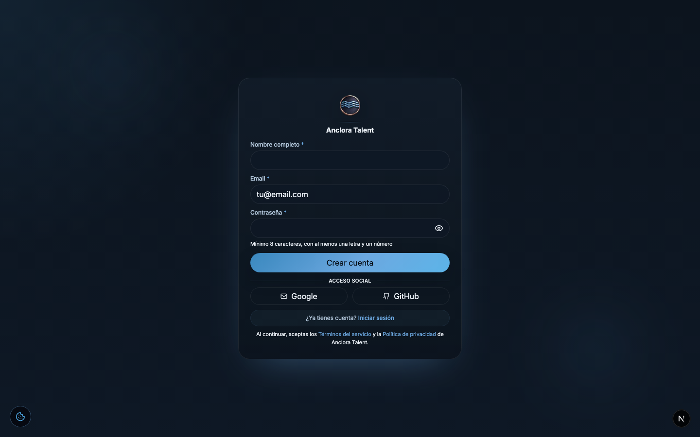

### Iniciar sesión

1. Pulsa **Iniciar sesión**.
2. Introduce tu **Email** y tu **Contraseña**.
3. Usa el botón de visibilidad del campo contraseña si quieres comprobar lo escrito antes de enviar.
4. Pulsa **Iniciar sesión**.

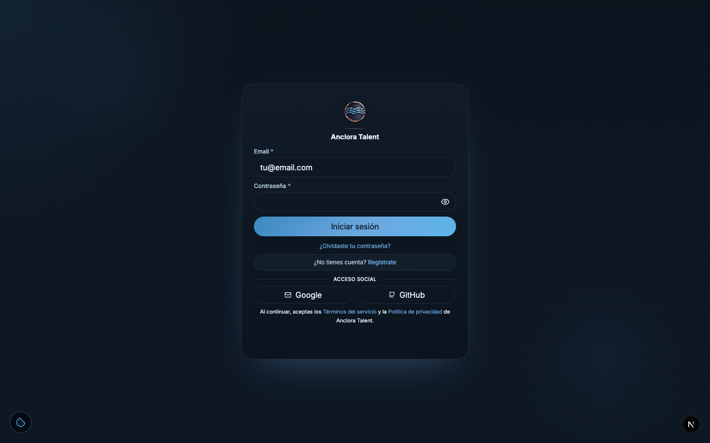

Si las credenciales no coinciden, verás un aviso general de acceso sin exponer si un correo concreto está registrado.

### Acceso social

En las pantallas de inicio de sesión y registro aparecen los proveedores configurados (**Google** y **GitHub**). Si un proveedor no está habilitado en el entorno actual, el control se muestra desactivado con la indicación **Próximamente**; en ese caso, accede con email y contraseña.

### Recuperar la contraseña

1. En la pantalla de inicio de sesión, pulsa **¿Olvidaste tu contraseña?**.
2. Escribe el email asociado a tu cuenta.
3. Pulsa **Enviar enlace de recuperación**.
4. Abre el enlace temporal de un solo uso recibido por correo y define tu nueva contraseña.

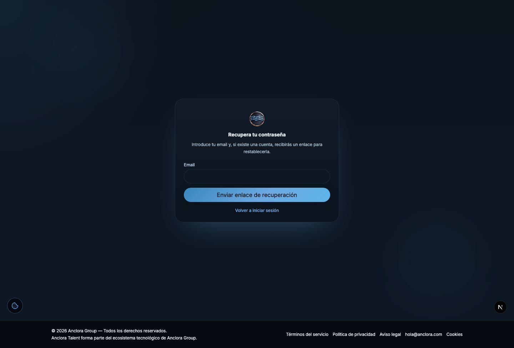

## 3. Dashboard y proyectos

Al iniciar sesión accedes al **Dashboard**, donde conviven el listado de **Mis proyectos** a la izquierda y el panel de **Actividad reciente** a la derecha. En la barra superior dispones del botón **Nuevo proyecto**, el selector de idioma (**ES** / **EN**), el selector de tema (**oscuro** / **claro**) y el menú de usuario.

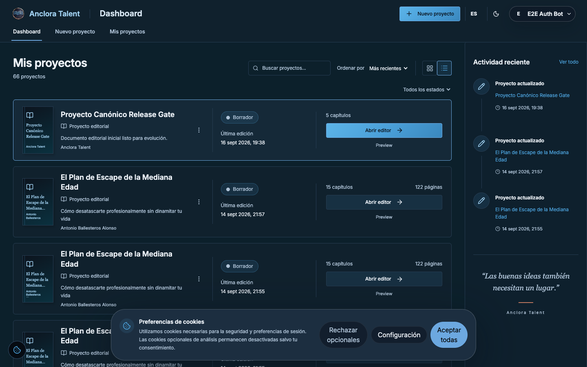

### Dashboard vacío

Cuando una cuenta aún no tiene proyectos creados, el panel principal muestra un estado de bienvenida con acceso directo a **Nuevo proyecto**.

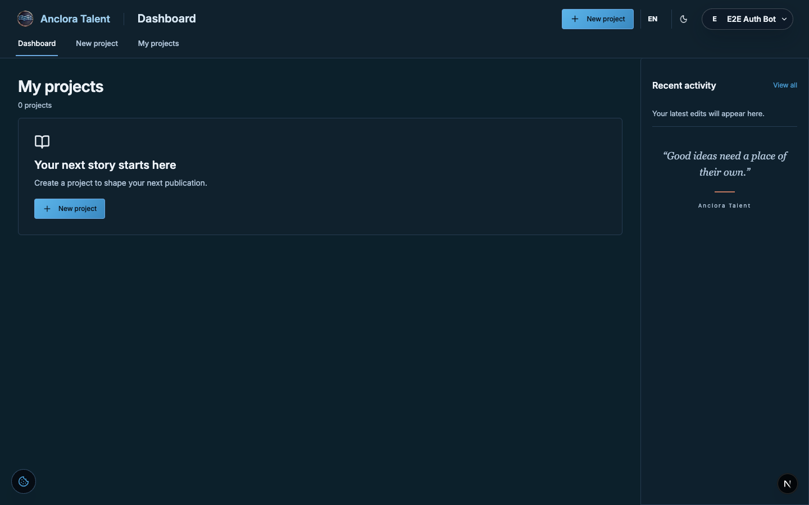

### Buscar, filtrar y gestionar proyectos

En **Mis proyectos** puedes localizar cualquier obra sin recorrer manualmente toda la lista:

- **Buscar proyectos:** filtra en tiempo real por título, subtítulo o autor.
- **Ordenar por:** elige entre **Recientes**, **Más antiguos** o **Título**.
- **Estado:** filtra por **Todos los estados**, **Activo** o **Borrador**.
- **Vista:** alterna entre vista de **lista** y vista de **cuadrícula**.
- **Menú de acciones (`⋮`):** en cada tarjeta puedes abrir directamente **Datos del documento** o **Eliminar** el proyecto tras confirmación.
- **Acciones directas:** pulsa **Abrir editor** para entrar al workspace del proyecto o **Vista previa** para abrir la lectura validada.

## 4. Crear un proyecto

Al pulsar **Nuevo proyecto** desde el Dashboard accedes a un espacio de creación previo al flujo de 8 pasos, organizado en cuatro bloques numerados a la izquierda y una tarjeta de **Resumen del proyecto** a la derecha.

1. **1. Proyecto:** define el **Título del proyecto** (obligatorio).
2. **2. Documento base y Plantilla de producto:** sube un manuscrito opcional (`.docx`, `.doc`, `.odt`, `.md`, `.txt` o `.pdf` hasta 50 MB) o empieza en blanco, y selecciona una plantilla base (**Libro estándar**, **Manual técnico**, **Guía / lead magnet**, **Curso modular** o **Bundle**).
3. **3. Estilo editorial:** elige **Sin referencia**, **Estilo de Talent**, **Mis estilos editoriales** o **Crear desde documento de referencia** para extraer tipografía, tamaños, interlineado y márgenes de un DOCX/PDF de muestra sin copiar su texto.
4. **4. Identidad de marca:** vincula o consulta el estado del manual de marca PDF cuando la función esté habilitada.
5. Revisa la columna **Resumen del proyecto** (**Documento**, **Plantilla**, **Estilo**, **Marca** y el indicador **Listo para crear**) y pulsa **Crear proyecto y abrir editor**.

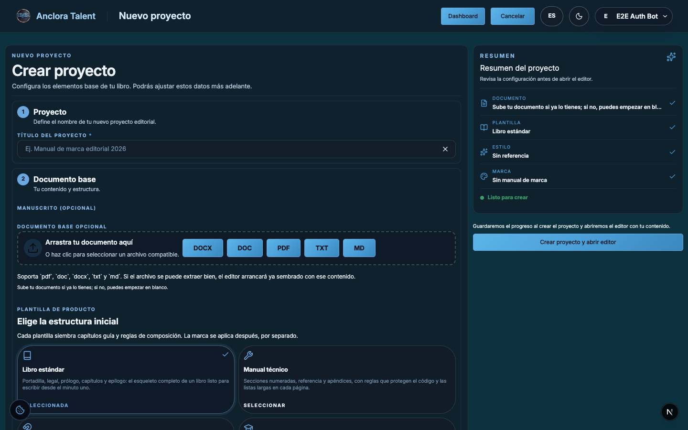

## 5. Workspace editorial

Una vez dentro de un proyecto, la cabecera compacta muestra el paso activo, el título de la obra, el estado de guardado (**Guardando…**, **Guardado**, **Guardado justo ahora**) y accesos rápidos a **Vista previa**, **Datos del documento** y **Dashboard**. Debajo se sitúa el **Stepper de 8 pasos**.

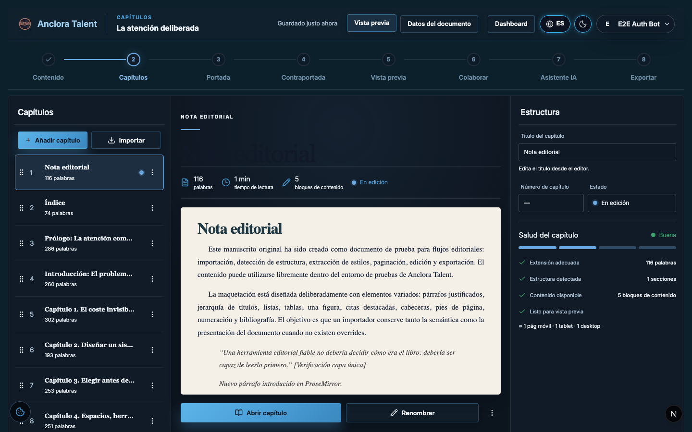

### Las 6 pestañas del Paso 1 (Contenido)

El paso **1. Contenido** actúa como centro de control global del libro y se organiza en seis pestañas:

- **Resumen:** vista en tres columnas con **Estado del documento** (portada en miniatura, título, subtítulo, autor, idioma, ISBN y tira de 5 métricas: capítulos, palabras, caracteres, tiempo de lectura y páginas estimadas), **Actividad reciente**, **Composición** (preset activo y recuento de reglas/violaciones), **Marca aplicada**, **Salud del documento** y **Pre-flight** por canal, además de la barra inferior de acciones rápidas (**Asistente editorial**, **Revisar coherencia**, **Guardar versión**, **Ver historial** y **Abrir vista previa**).
- **Metadatos:** formulario editorial completo con sincronización automática hacia portada, contraportada y exportación, chips de palabras clave (hasta 10), sinopsis (hasta 1000 caracteres) e indicador de **Completitud de metadatos** en porcentaje.
- **Composición:** selección de presets (**Maquetación print sin sustos**, **Empezar con buen pie**, **Publicar sin rechazos**) y configuración detallada dividida en **Paginación**, **Tipografía**, **Estructura**, **Numeración** y **Exportación**.
- **Marca:** inspección del sistema visual aplicado (paleta con roles `ink`, `paper`, `accent`, `accentMuted`, par tipográfico y superficies conectadas).
- **Pre-flight:** validación por canal (**Amazon KDP**, **IngramSpark**, **Kobo** y **PDF / EPUB**), filtros por severidad (**Todos**, **Errores**, **Avisos**, **Info**), porcentaje de preparación y panel de **Salud del documento**.
- **Versiones:** línea temporal de instantáneas guardadas, comparador de diferencias por capítulo/bloque y restauración de versiones anteriores.

## 6. Importar y preparar el manuscrito

### Formatos y modos de documento

- **Documentos editables (`.docx`, `.doc`, `.odt`, `.md`, `.txt`):** Talent extrae capítulos, encabezados, párrafos, listas, citas, tablas, notas e imágenes, aislando el índice original para que los números de página del TOC antiguo no contaminen los títulos de capítulo. Cuando el archivo de origen contiene paginación certificada, conserva el mapa de páginas de origen (`sourcePageMap`).
- **Modo PDF de diseño fijo (`fixed-pdf`):** cuando importas un PDF y eliges conservar su maquetación original, los pasos de capítulos, portada y contraportada se marcan como ya incluidos en el PDF original, y en **Exportar** puedes descargar el PDF original intacto o pulsar **Crear copia editable** para transformarlo en un proyecto editable.

### Modal «Datos del documento»

Al terminar el análisis de un manuscrito (o en cualquier momento pulsando **Datos del documento** en la cabecera del workspace o en el menú de una tarjeta del Dashboard), se abre un diálogo amplio donde puedes:

- Revisar el origen tipográfico detectado (**verificado en fuente** para estilos extraídos de Word/ODT o presentación generada para Markdown/TXT).
- Ajustar familia tipográfica, cuerpo en puntos (`pt`), interlineado y márgenes (**Compacto**, **Normal**, **Amplio**, **Estilo libro**, **Mínimo** o **Personalizado**).
- Elegir el alcance de la composición: **Solo este proyecto** o **Todos mis proyectos** (con opción de sobrescribir proyectos personalizados).
- Consultar la **Estructura detectada** (jerarquía de encabezados y patrón macro con nivel de confianza).

## 7. Capítulos, edición y formato

### Paso 2 — Organizador de capítulos

El paso **2. Capítulos** presenta tres columnas dedicadas a la arquitectura del manuscrito:

- **Columna izquierda (`Capítulos`):** botones **Añadir capítulo** e **Importar**, lista numerada de capítulos con recuento de palabras y menú `⋮` por fila (**Editar capítulo**, **Mover capítulo arriba**, **Mover capítulo abajo**, **Eliminar capítulo**), pie con totales y botones **Sincronizar numeración** y **Reimportar DOCX**.
- **Columna central (`Vista general`):** etiqueta semántica (`CAPÍTULO N`, `PARTE N`, `PRÓLOGO`, `INTRODUCCIÓN`, `ÍNDICE`, etc.), título, métricas de palabras/lectura/bloques, vista previa representativa de la primera página del capítulo y botones **Abrir capítulo** y **Renombrar**.
- **Columna derecha (`Propiedades / Estructura`):** título, número de capítulo, estado e indicadores de **Salud del capítulo**.

### Editor de capítulos a pantalla completa

Al pulsar **Abrir capítulo** (o **Editar capítulo**), el organizador se reemplaza por el editor multipágina a pantalla completa:

- **Cabecera del editor:** botón **Volver a Capítulos**, título del capítulo activo, navegación **Capítulo anterior** / **Capítulo siguiente**, paginador **Pág. anterior** / **Pág. siguiente**, controles de zoom (`50%`–`150%`), botón **Guardar** y conmutadores para mostrar/ocultar el **Esquema** lateral, el inspector de **Capítulo** y el **Modo enfoque**.
- **Barra de herramientas:** selector de familia tipográfica y tamaño, color de texto, negrita, cursiva, tachado, alineación (izquierda, centro, derecha, justificado), sangría de primera línea y controles de párrafo, listas con viñetas y numeradas, inserción de imágenes (en flujo o posicionadas libremente con guías de alineación al centro) y saltos de página.
- **Superficie editable única:** lienzo paginado sobre papel editorial donde escribes directamente viendo los saltos de página reales y el pie de página.

## 8. Composición, metadatos, marca y versiones

### Reglas de composición y paginación

Desde **Contenido → Composición** puedes gobernar cómo el motor pagina tu obra:

- **Salto de página antes de cada capítulo** y **Capítulo en página impar (recto)** para impresión.
- **Líneas mínimas tras un encabezado** (`keepWithNext`) y control de **viudas y huérfanas** (`widowsOrphans`).
- **Bloques indivisibles (`keepTogether`):** evita partir tablas, citas, avisos, bloques de código, imágenes con pie o listas cortas.
- **Numeración:** reinicio de figuras y tablas por capítulo y formato de numeración de página (**Decimal**, **Romano minúsculas**, **Romano mayúsculas**).
- **Puerta de exportación (`exportGate`):** define si las violaciones de composición e incidencias críticas deben **Bloquear**, **Advertir** o **Ignorarse** al exportar.

### Pre-flight y reversión rápida

En **Contenido → Pre-flight**, además de revisar las reglas de **KDP**, **IngramSpark** y **Kobo**, puedes solicitar una propuesta de corrección automática para incidencias compatibles o revertir la última recomposición guardada desde el banner de **Salud del documento**.

## 9. Portada y contraportada

Los pasos **3. Portada** y **4. Contraportada** comparten el estudio de diseño unificado (**Cover Studio v2**), manteniendo estados e historiales independientes para cada superficie.

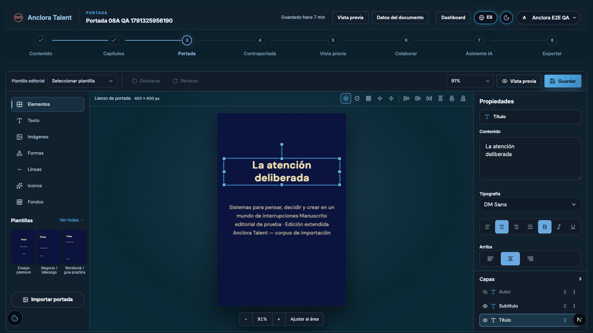

### Cómo trabajar en Portada (Paso 3)

- **Barra superior del estudio:** selector de **Plantilla editorial**, botones **Deshacer** y **Rehacer**, selector de zoom (**Ajustar al área**, `50%`–`200%`) y botón **Guardar**.
- **Panel izquierdo de herramientas:** añade o selecciona **Elementos**, **Texto**, **Imágenes**, **Formas**, **Líneas**, **Iconos** y **Fondos**, consulta la miniatura de la plantilla activa o pulsa **Importar portada** para cargar una imagen completa (con aviso automático si la resolución es baja).
- **Lienzo central:** arrastra, redimensiona y rota capas directamente; en la cabecera del lienzo puedes activar **Ajuste magnético (snap)**, **Área segura**, **Sangrado (bleed)**, **Reglas** y **Cuadrícula**, o usar los botones de alineación y distribución cuando seleccionas varios elementos.
- **Panel derecho (`Propiedades` y `Capas`):** edita el texto, tipografía, color, opacidad, posición (`X`, `Y`), tamaño (`Ancho`, `Alto`), rotación, recorte o conversión entre capa de imagen y fondo, y gestiona el orden, agrupación, bloqueo y visibilidad en la lista de **Capas**.

### Cómo trabajar en Contraportada (Paso 4)

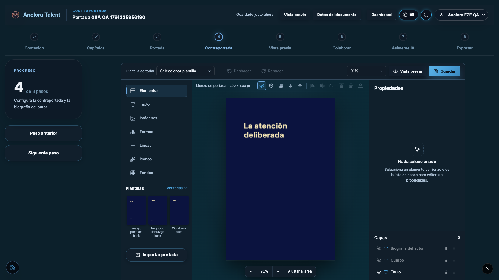

El paso **4. Contraportada** ofrece un catálogo propio de plantillas traseras y enlaza semánticamente los bloques de **Sinopsis**, **Biografía del autor**, **Sello editorial (imprint)** y reserva de **ISBN / código de barras**.

## 10. Vista previa, colaboración y asistente IA

### Paso 5 — Vista previa

El paso **5. Vista previa** es el espacio único de validación editorial (sin necesidad de abrir modales intermedios):

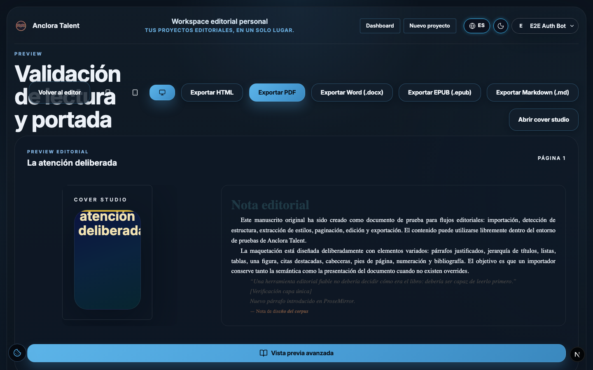

- **Carril izquierdo (`Páginas`):** miniaturas numeradas de la portada, páginas preliminares/contenido y contraportada para saltar directamente a cualquier página.
- **Barra de herramientas superior:** selector de modo (**Documento** de 1 página, **Pliego** de 2 páginas enfrentadas o **Portada** enfocada con selector **Portada | Contraportada**), navegador de páginas, controles de zoom, botón **Ajustar**, pantalla completa y botón **Exportar** (que lleva al paso 8).
- **Panel derecho (`Composición`):** selector de **Destino de lectura** (**Impresión**, **Escritorio**, **Tableta**, **Lector electrónico**), formato y márgenes efectivos, desglose de páginas (**Total**, **Contenido**, **Preliminares**, **Cubierta**) y **Comprobación previa (preflight)** con salto directo a la página afectada.

### Paso 6 — Colaborar

El paso **6. Colaborar** organiza la revisión en equipo en tres columnas:

- **Equipo (izquierda):** muestra al propietario/autor, colaboradores activos (**Corrector** o **Maquetador**) e invitaciones pendientes, con el botón **Invitar colaborador** (que genera un enlace de invitación y envía correo). Los colaboradores también pueden acceder mediante la ruta dedicada `/projects/[id]/collaborate`.
- **Lector de capítulos (centro):** selector de capítulo y visualización de cada bloque del manuscrito con contador de hilos abiertos y botón **Comentar**.
- **Comentarios y Sugerencias (derecha):** pestaña **Comentarios** (con filtro **Abiertos / Resueltos / Todos**, respuestas y botón **Resolver** para el autor) y pestaña **Sugerencias** (donde los correctores proponen cambios con diff **Antes / Después** y el autor acepta o rechaza).

### Paso 7 — Asistente IA

El paso **7. Asistente IA** es un espacio de trabajo editorial gobernado y orientado a propuestas (nunca modifica el manuscrito sin tu aceptación explícita):

- **Columna izquierda (`Manuscrito`):** selección de capítulo objetivo o **Documento completo**.
- **Columna derecha (`Acciones editoriales` y `Contexto activo`):** tareas de **Escritura** (**Mejorar estilo**, **Reorganizar capítulo**), **Documento** (**Crear resumen**, **Revisar coherencia** local determinista) y **Correcciones** (**Resolver problemas detectados** en pre-flight/composición), junto con el resumen de contexto (voz editorial de marca, modo de procesamiento local o cloud) e **Historial IA** de operaciones aceptadas.
- **Columna central:** ejecuta la tarea seleccionada y presenta la tarjeta de revisión con resumen de impacto, cambios agrupados por capítulo y tipo (**Modificado**, **Añadido**, **Eliminado**, **Movido**), comparativa **Antes / Después** y botones **Aceptar cambios** o **Rechazar** (con protección ante propuestas desactualizadas si el capítulo cambió mientras tanto).

## 11. Exportar

El paso **8. Exportar** concentra la generación y verificación de entregables en tres columnas más una barra inferior de estado:

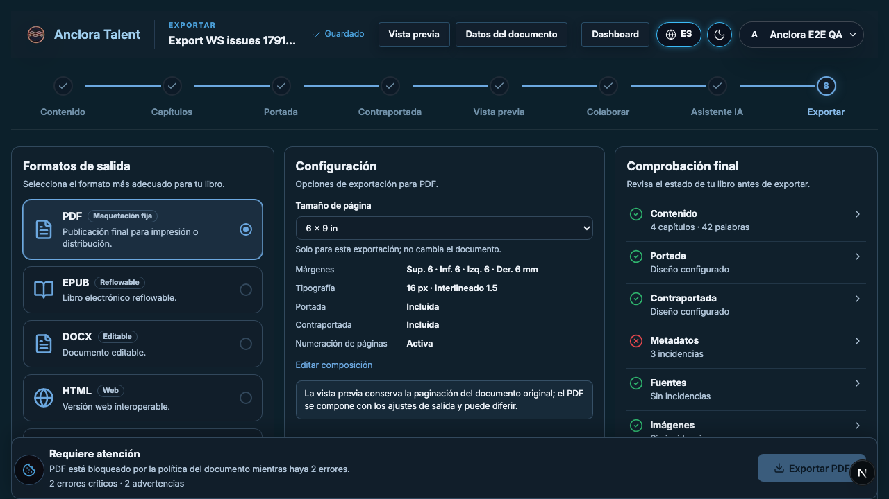

### Cómo exportar y verificar tu publicación

1. **Formatos de salida (izquierda):** selecciona mediante tarjetas de radio el formato deseado:
   - **PDF (`Diseño fijo`):** paginación compuesta lista para imprenta o lectura digital con portada y contraportada integradas (o descarga del PDF original en proyectos `fixed-pdf`).
   - **EPUB (`Reflowable`):** libro electrónico adaptable con tabla de navegación de 3 niveles y validación estructural.
   - **DOCX (`Editable`):** documento Word con texto editable, estilos de encabezado, listas y tablas.
   - **HTML (`Web`):** documento web semántico autocontenido con estilos de marca.
   - **Markdown (`Texto`):** texto estructurado limpio con encabezados y formato semántico.
2. **Configuración (centro):** revisa o ajusta el **Tamaño de página** de salida (por ejemplo `6 × 9 in`, `5.5 × 8.5 in`, etc. para PDF/DOCX sin alterar tu proyecto guardado), márgenes, tipografía, inclusión de portada/contraportada, numeración y el bloque de **Metadatos** (**Título**, **Autor**, **Idioma**, **ISBN**), además del nombre de archivo resultante.
3. **Comprobación final (derecha):** verifica el estado de **Contenido**, **Portada**, **Contraportada**, **Metadatos**, **Fuentes**, **Imágenes**, **Composición** y **Uso de IA** (incluyendo el panel de **Declaración de contenido IA para KDP** cuando se han aceptado propuestas del asistente). Cada fila es interactiva y te lleva al paso correspondiente si necesitas corregir algo.
4. **Barra inferior y verificación del archivo:** comprueba el estado (**Listo para exportar** o **Requiere atención**) y pulsa **Exportar {formato}**. Antes de iniciar la descarga, Talent valida en el navegador la integridad real del archivo generado (cabeceras, páginas PDF, `word/document.xml` en DOCX, estructura OPF/NAV en EPUB, cierre HTML) y muestra la tarjeta **Archivo generado** junto con la lista **Exportados en esta sesión**.

Además, al final del paso puedes desplegar **Pack de lanzamiento y canales de venta** para generar el manifiesto multiformato o sincronizar borradores con **Gumroad** / **Hotmart** cuando estén configurados.

## 12. Trabajar en móvil y tablet

Anclora Talent adapta el shell, los paneles laterales y el editor de capítulos a pantallas estrechas para evitar recortes horizontales.

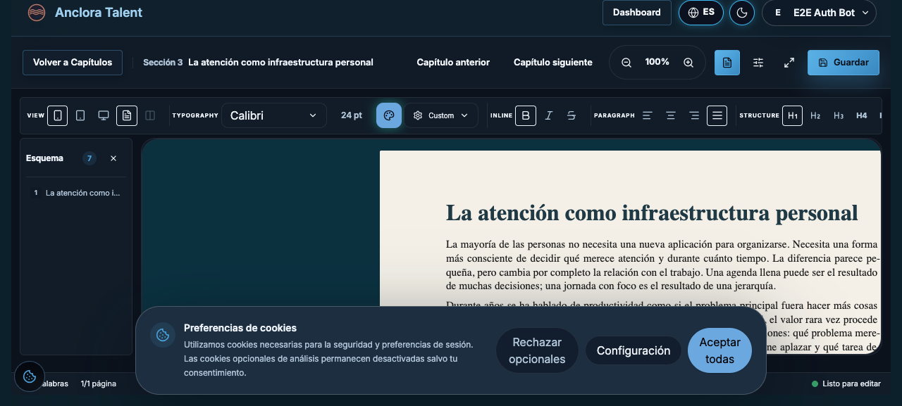

- En **móvil (`375px`–`430px`)**, el documento del editor se muestra en una sola columna ajustada al ancho físico de la pantalla sin modificar el formato de exportación guardado en tu proyecto.
- En **Vista previa (Paso 5)**, **Colaborar (Paso 6)** y **Asistente IA (Paso 7)**, las columnas laterales de páginas, composición, equipo o contexto se pliegan en cajones accesibles mediante botones superiores.
- En **Exportar (Paso 8)**, las tres columnas se apilan verticalmente manteniendo accesibles la selección de formato, la configuración y el botón de descarga.

## 13. Idioma, tema y preferencias

### Cambiar idioma (`ES` / `EN`)

En la barra superior, pulsa **ES** o **EN** para alternar toda la interfaz operativa entre español e inglés. El idioma elegido se guarda en tus preferencias sin traducir ni alterar el contenido de tu manuscrito.

### Cambiar tema (`Oscuro` / `Claro`)

La aplicación inicia en modo **oscuro** (`quiet luxury` azul cielo `#4A9FD8` sobre navy/teal profundo). Pulsa el icono de sol/luna en la cabecera para alternar con el modo **claro** cálido (`#F2F7FC`). El cambio de tema afecta únicamente a la interfaz de la aplicación, nunca al color del papel ni a las portadas exportadas.

## 14. Si algo no funciona

| Problema | Posible causa | Qué hacer |
| --- | --- | --- |
| No puedo iniciar sesión | Email o contraseña incorrectos | Revisa ambos campos o usa **¿Olvidaste tu contraseña?** |
| No encuentro un proyecto | Filtro de estado o búsqueda activa | Limpia el campo **Buscar proyectos** y selecciona **Todos los estados** en el Dashboard |
| El botón de exportar está desactivado | Política `exportGate` en modo **Bloquear** con errores activos, o formato no aplicable en modo `fixed-pdf` | Revisa la columna **Comprobación final** en el Paso 8 o cambia la puerta de exportación en **Contenido → Composición → Exportación** |
| Una propuesta del Asistente IA aparece como desactualizada | El capítulo se editó después de generar la propuesta | Pulsa **Regenerar propuesta** en el Paso 7 para calcular el diff sobre el texto actual |
| Los números del índice no coinciden tras reordenar capítulos | Orden modificado en el Paso 2 | Pulsa **Sincronizar numeración** en la columna izquierda de **Capítulos** |
| Quiero editar el texto de un PDF importado en modo fijo | El proyecto está en modo `fixed-pdf` | Ve al Paso 8 (**Exportar**) y pulsa **Crear copia editable** |

## 15. Preguntas frecuentes

### ¿Puedo empezar un libro sin subir ningún archivo?

Sí. En **Nuevo proyecto**, escribe el título, elige una plantilla y pulsa **Crear proyecto y abrir editor** dejando vacío el bloque de manuscrito.

### ¿Cambiar el destino en Vista previa modifica mi libro?

No. Cambiar entre **Impresión**, **Escritorio**, **Tableta** y **Lector electrónico** en el Paso 5 solo cambia la simulación de lectura; nunca sobrescribe tus capítulos ni tus reglas guardadas.

### ¿El Asistente IA modifica mis capítulos automáticamente?

Nunca. Toda acción en el Paso 7 genera una propuesta de operaciones sobre bloques que puedes inspeccionar con diff **Antes / Después** y debes **Aceptar** o **Rechazar** manualmente.

### ¿Cuándo se activa el aviso de divulgación de IA para Amazon KDP?

Solo cuando aceptas propuestas generadas o asistidas por IA (o cuando el documento registra procedencia IA). Las revisiones rechazadas o descartadas no alteran el manuscrito ni activan la declaración.

### ¿Cómo sé que el archivo descargado en Exportar no está vacío ni corrupto?

El Paso 8 verifica automáticamente los bytes y la estructura interna del archivo (PDF, EPUB, DOCX, HTML o Markdown) antes de ofrecer la descarga y muestra las comprobaciones superadas en la tarjeta **Archivo generado**.

## 16. Glosario

| Término | Significado |
| --- | --- |
| **AST / Documento semántico** | Representación estructurada de capítulos y bloques (encabezados, párrafos, listas, tablas, citas, imágenes) que sirve de fuente única |
| **Mapa de páginas de origen (`sourcePageMap`)** | Correspondencia certificada entre las páginas físicas del documento importado y las páginas mostradas en el editor y la vista previa |
| **Estilo editorial de referencia** | Perfil tipográfico y de márgenes extraído de un documento DOCX/PDF modelo sin copiar su contenido |
| **Perfil de marca (`BrandProfile`)** | Conjunto reutilizable de colores semánticos (`ink`, `paper`, `accent`, `accentMuted`), tipografías y voz editorial |
| **Pre-flight** | Validación previa de metadatos, estructura y composición frente a los requisitos de **KDP**, **IngramSpark** y **Kobo** |
| **Cover Studio v2** | Estudio unificado de los pasos 3 y 4 para diseñar portada y contraportada por capas o plantillas |
| **Propuesta IA gobernada** | Conjunto de cambios sobre bloques con vista previa antes/después que requiere aceptación humana explícita |
| **Puerta de exportación (`exportGate`)** | Regla del proyecto (`off`, `warn`, `block`) que decide si los errores de composición o pre-flight bloquean la exportación por formato |
